# Detección de patrones de ataque lentos y distribuidos utilizando redes neuronales recurrentes

### Módulo XGBoost

Trabajo de graduación — Universidad del Valle de Guatemala, Facultad de Ingeniería.

## Descripción

Los ataques de denegación de servicio **lentos** (*low and slow*), como **Slowloris** y **Slowhttptest**, no saturan el servidor con volumen: abren conexiones HTTP y las mantienen vivas enviando datos muy despacio hasta agotar los recursos del servidor web. Por eso su tráfico se parece mucho al tráfico legítimo y es difícil de detectar con reglas de umbral simples.

Este repositorio contiene el **módulo XGBoost** del trabajo de graduación, que compara una red recurrente GRU con modelos tradicionales de aprendizaje automático. El problema se plantea como **clasificación binaria por flujo** (tráfico benigno vs. ataque) sobre la captura del miércoles 5/7/2017 del dataset **CIC-IDS2017** (Canadian Institute for Cybersecurity, UNB).

### Cómo funciona

1. **Limpieza compartida** (`src/src/preprocessing/clean.py`): carga del CSV del miércoles (`GeneratedLabelledFlows`), filtrado de tráfico benigno y ataques Slowloris/Slowhttptest (se descartan DoS Hulk, GoldenEye y Heartbleed), exclusión de las respuestas del servidor a conexiones de ataque, corrección del `Timestamp` y eliminación de identificadores, atajos de laboratorio (`Destination Port`, `Source Port`, `Protocol`) y columnas sin valor informativo.
2. **Partición cronológica por bloques**: el tráfico se divide en 5 bloques temporales y cada bloque se corta 70/15/15 en entrenamiento, validación y prueba, respetando el orden en el tiempo para evitar fuga de información (ver `src/docs/adr/0001-split-cronologico-por-bloques-temporales.md`).
3. **Ingeniería de características**: se eliminan columnas redundantes y el modelo queda con **55 características** de flujo.
4. **Modelo XGBoost** entrenado con el conjunto real (sin SMOTE, según la ablación del notebook `02b`) y con `scale_pos_weight` = benignos / ataques (≈ 36.73) para compensar el desbalance. Hiperparámetros finales: `learning_rate=0.3`, `max_depth=4`, `min_child_weight=1`, *early stopping* con `aucpr` (`best_iteration` = 68).
5. **Umbral de decisión 0.87**, elegido **solo con el conjunto de validación** (mayor F2 con recall ≥ 0.75). El conjunto de prueba se usó una única vez, con el modelo ya congelado.

### Resultados en prueba

Métricas sobre el subconjunto de prueba común con la GRU (66 454 flujos, 1 164 ataques), tomadas de `src/reports/metrics/xgboost_comun.json`:

| Métrica | Valor |
|---|---|
| Recall (clase ataque) | 0.9905 |
| Precisión | 0.9931 |
| F1-score | 0.9918 |
| ROC-AUC | 0.9999 |

Matriz de confusión (umbral 0.87):

|  | Predicho benigno | Predicho ataque |
|---|---|---|
| **Real benigno** | TN = 65 282 | FP = 8 |
| **Real ataque** | FN = 11 | TP = 1 153 |

Los resultados sobre el conjunto de prueba completo (66 544 flujos), los intervalos de confianza por *bootstrap* y el recall por tipo de ataque están en `src/reports/xgboost/resultados_test.json`.

### Estructura del repositorio

```
.
├── capturas/                  # Capturas de pantalla
├── demo/                      # Video de demostración (demo.mp4)
├── docs/                      # Informe final y consentimiento firmado
├── src/
│   ├── .env.example           # No se requieren variables de entorno
│   ├── conftest.py            # Agrega src/ al sys.path para pytest
│   ├── requirements.txt
│   ├── app_demo/              # Demo interactiva en Streamlit (solo XGBoost)
│   ├── data/                  # raw/, processed/, sequences/ (no versionadas)
│   ├── docs/                  # ADR, auditoría del baseline y guía de pruebas
│   ├── models/xgboost/        # Modelo congelado (xgboost_final.json) y metadatos
│   ├── notebooks/
│   │   ├── Cleaning/          # Limpieza y análisis exploratorio
│   │   └── xgboost/           # Notebooks 01 a 09 del módulo XGBoost
│   ├── reports/               # Métricas (JSON/CSV) y figuras
│   ├── results/gru/           # Índices del subconjunto de prueba común con la GRU
│   ├── src/                   # Código fuente: preprocessing/, models/, evaluation/
│   └── tests/                 # Pruebas con pytest
├── .gitignore
├── LICENSE
└── README.md
```

## Tecnologías utilizadas

- **Python 3.12**
- **pandas** y **NumPy**: manejo de datos.
- **scikit-learn**: escalado, métricas y utilidades de evaluación.
- **XGBoost**: modelo de clasificación.
- **imbalanced-learn**: SMOTE, usado solo en la ablación del notebook `02b`.
- **matplotlib** y **seaborn**: figuras.
- **Jupyter**: notebooks del pipeline.
- **pytest**: pruebas automatizadas.
- **joblib**: utilidades de serialización.
- **Streamlit**: demo interactiva (`src/app_demo/`).

## Requisitos previos

- Python 3.10 a 3.12
- pip
- git
- Jupyter (se instala con `requirements.txt`)
- El dataset **CIC-IDS2017**, descargado de <https://www.unb.ca/cic/datasets/ids-2017.html>. Se usa la versión **`GeneratedLabelledFlows`** (incluye `Timestamp` e IPs), no `MachineLearningCSV`. El único archivo que necesita el pipeline es `TrafficLabelling/Wednesday-workingHours.pcap_ISCX.csv`, que debe colocarse dentro de `src/data/raw/` (por ejemplo, `src/data/raw/TrafficLabelling/Wednesday-workingHours.pcap_ISCX.csv`). El cargador busca de forma recursiva y, si encuentra los CSV de todos los días, elige automáticamente el del miércoles.

El dataset **no está incluido** en el repositorio por su tamaño (varios GB).

## Instalación

1. Clonar el repositorio:

   ```bash
   git clone https://github.com/GraduacionesUVG/2026-22305-ortega-kou-edwin-andres.git
   cd 2026-22305-ortega-kou-edwin-andres
   ```

2. Crear y activar un entorno virtual:

   Linux / macOS:

   ```bash
   python3 -m venv .venv
   source .venv/bin/activate
   ```

   Windows (PowerShell):

   ```powershell
   python -m venv .venv
   .venv\Scripts\activate
   ```

3. Instalar las dependencias:

   ```bash
   pip install -r src/requirements.txt
   ```

   > `tensorflow` aparece en `requirements.txt` porque lo usa el módulo GRU; **no es necesario** para el módulo XGBoost y puede omitirse de la instalación.

   Para la demo interactiva se necesitan además sus dependencias (incluye Streamlit):

   ```bash
   pip install -r src/app_demo/requirements.txt
   ```

4. Colocar el CSV del miércoles de CIC-IDS2017 en `src/data/raw/` (ver [Requisitos previos](#requisitos-previos)).

5. (Opcional) Copiar el archivo de ejemplo de variables de entorno. El proyecto no requiere ninguna variable:

   ```bash
   cp src/.env.example src/.env
   ```

## Ejecución

### a) Pruebas

```bash
cd src
pytest
```

- `tests/test_clean.py`: 14 pruebas unitarias de la partición cronológica y del escalado, con datos sintéticos. **No** requieren el dataset.
- `tests/test_integration.py`: corre el pipeline real (`load_and_clean` → `train_test_split_by_flow` → `scale_features`) sobre `src/data/raw/`. **Requiere el dataset crudo**; si no hay CSV en `src/data/raw/`, se omite automáticamente.

### b) Pipeline

Ejecutar los notebooks desde Jupyter, en este orden:

1. `src/notebooks/Cleaning/limpieza_low_and_slow.ipynb`: genera `src/data/processed/wednesday_low_and_slow_clean.csv` a partir del CSV crudo.
2. `src/notebooks/Cleaning/Analisis_Exploratorio_actualizado.ipynb` (opcional): análisis exploratorio del dataset limpio.

Luego, los notebooks de `src/notebooks/xgboost/`:

| Notebook | Qué hace |
|---|---|
| `01_feature_engineering.ipynb` | Aplica la partición cronológica, elimina columnas y guarda `X/y` de train, val y test en `src/data/processed/xgboost/`. |
| `02_modelo.ipynb` | Entrena un modelo base con hiperparámetros por defecto y lo evalúa en validación. |
| `02b_ablacion_smote.ipynb` | Compara SMOTE, sin pesos y `scale_pos_weight`; elige `scale_pos_weight`. |
| `03_tuning.ipynb` | Búsqueda ligera de hiperparámetros evaluada en validación. |
| `04_umbral.ipynb` | Elige el umbral de decisión (0.87) en validación. |
| `05_verificacion_modulo.ipynb` | Verifica `src/src/models/xgboost/model.py` y guarda el modelo congelado. |
| `06_evaluacion_final.ipynb` | Evaluación final en prueba (completa y subconjunto común con la GRU). |
| `07_importancia.ipynb` | Importancia de características por *gain*. |
| `08_figuras_resultados.ipynb` | Figuras del capítulo de resultados y comparación de modelos. |
| `09_analisis_errores.ipynb` | Análisis de los flujos mal clasificados. |

> El notebook `08` lee también los resultados de los módulos SVM y GRU (`src/reports/comparacion/test_resultadosSVM.json` y `test_resultadosGRU.json`), que pertenecen a otros integrantes y no se incluyen en este repositorio. La figura ya generada está en `src/reports/xgboost/figuras/comparacion_modelos.png`.

### c) Uso del modelo entrenado

El modelo final está congelado en `src/models/xgboost/xgboost_final.json`. Ejemplo mínimo (desde la raíz del repositorio), usando el `X_test.csv` que genera el notebook `01`:

```python
import json

import pandas as pd
import xgboost as xgb

booster = xgb.Booster()
booster.load_model("src/models/xgboost/xgboost_final.json")

with open("src/models/xgboost/xgboost_final_metadatos.json", encoding="utf-8") as f:
    metadatos = json.load(f)

X = pd.read_csv("src/data/processed/xgboost/X_test.csv")
X = X[booster.feature_names]  # las 55 características, en el orden del modelo

proba = booster.predict(
    xgb.DMatrix(X),
    iteration_range=(0, metadatos["best_iteration"] + 1),
)
prediccion = (proba >= metadatos["umbral"]).astype(int)  # 1 = ataque, 0 = benigno
```

### d) Demo interactiva

La demo en Streamlit carga el modelo congelado de `src/models/xgboost/` y los datos de prueba incluidos en `src/app_demo/Data_Test/xgboost/` (no requiere el dataset crudo):

```bash
cd src/app_demo
streamlit run app.py
```

En la barra lateral, seleccionar el modelo **XGBoost**, el origen de datos **"Archivos locales"** y el umbral **0.87** (valor por defecto, leído de los metadatos), y presionar **"Ejecutar predicciones"**. La matriz de confusión esperada es **TN 65 282 · FP 8 · FN 11 · TP 1 153**.

## Capturas

Las capturas están en la carpeta [`capturas/`](capturas/).

Las capturas 01 a 06 muestran la demo interactiva en Streamlit. Este repositorio incluye en [`src/app_demo/`](src/app_demo/) su versión adaptada, que contiene solo el módulo XGBoost.

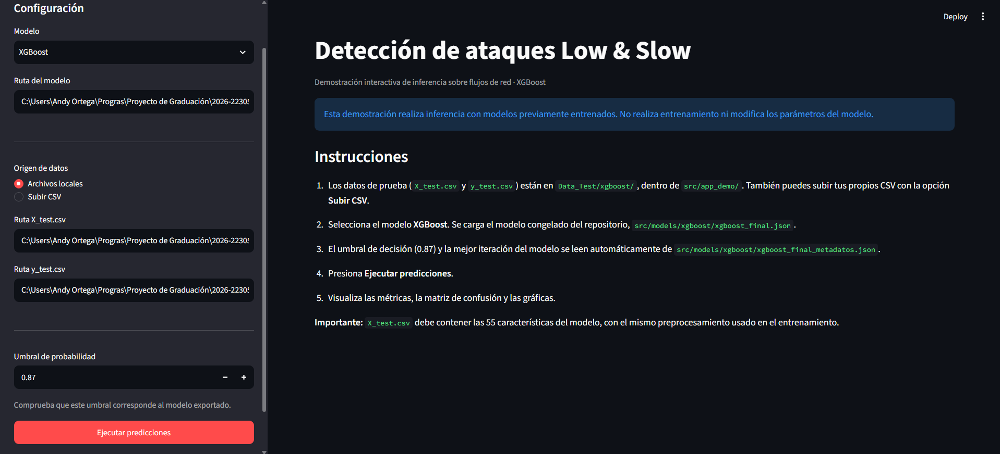
*Captura 01. Demo en vivo: configuración con modelo XGBoost y umbral 0.87.*

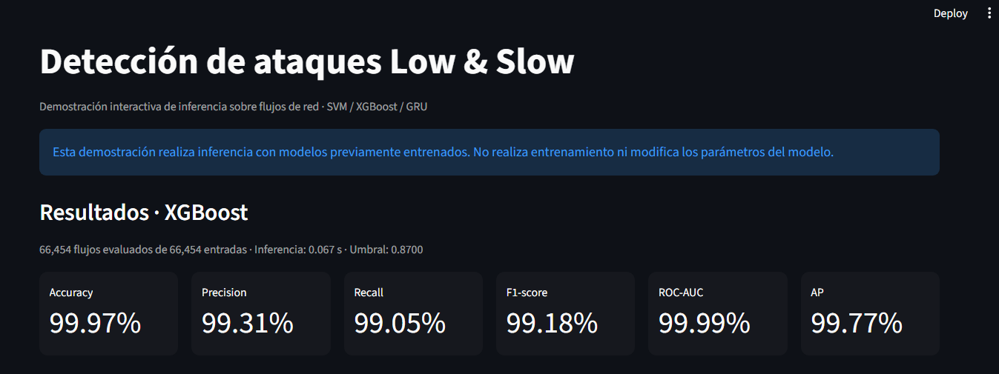
*Captura 02. Demo en vivo: métricas de la evaluación en test.*

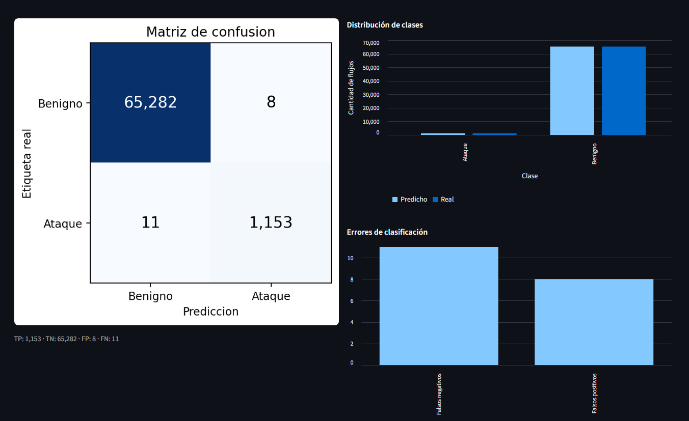
*Captura 03. Demo en vivo: matriz de confusión.*

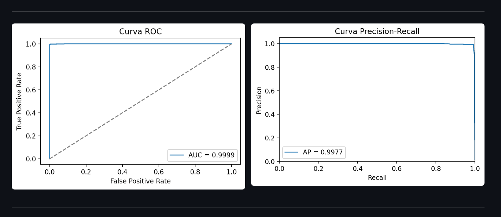
*Captura 04. Demo en vivo: gráficas de desempeño.*

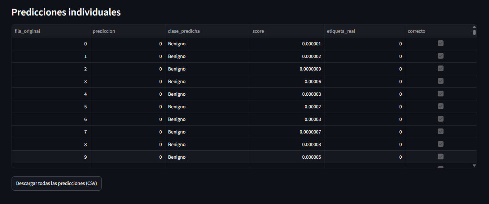
*Captura 05. Demo en vivo: predicciones individuales y descarga CSV.*

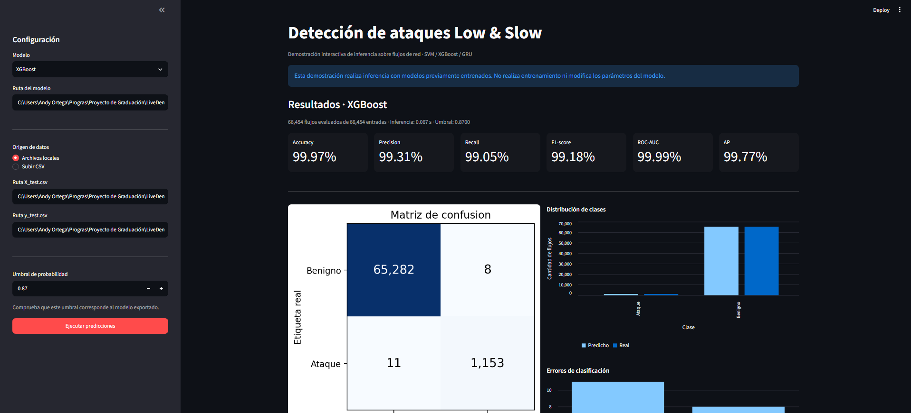
*Captura 06. Demo en vivo: vista general con la configuración y los resultados de la evaluación.*

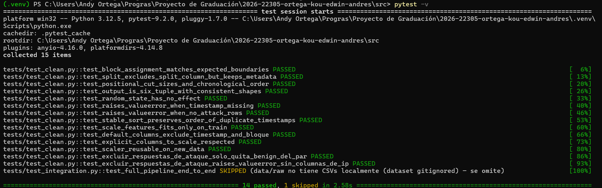
*Captura 07. Ejecución de pruebas con pytest.*

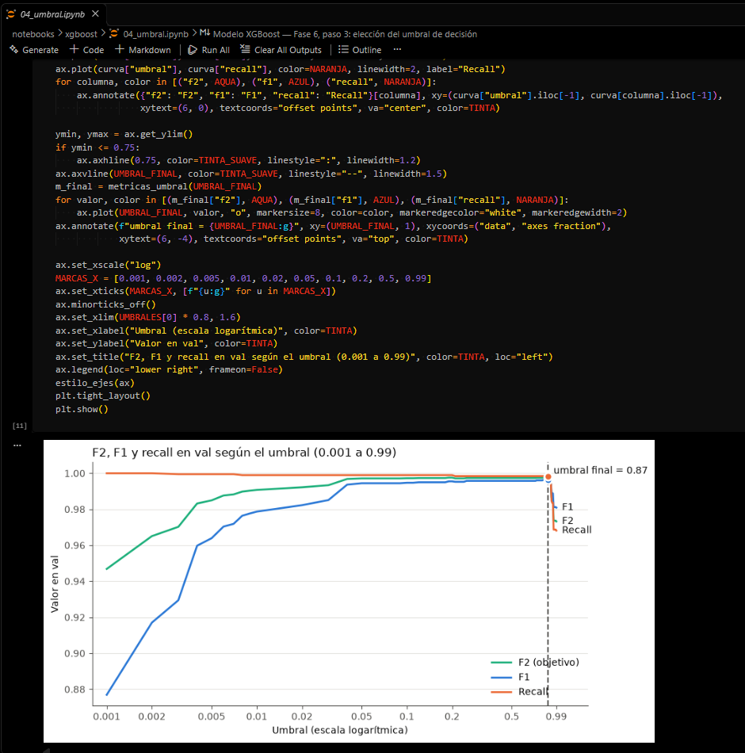
*Captura 08. Notebook 04: selección del umbral.*

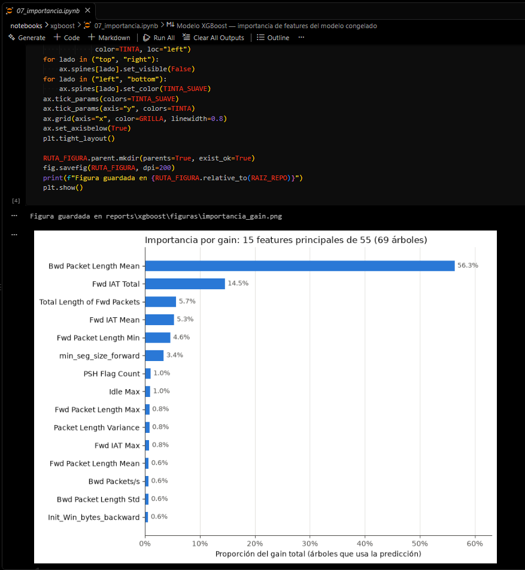
*Captura 09. Notebook 07: importancia de características (gain).*

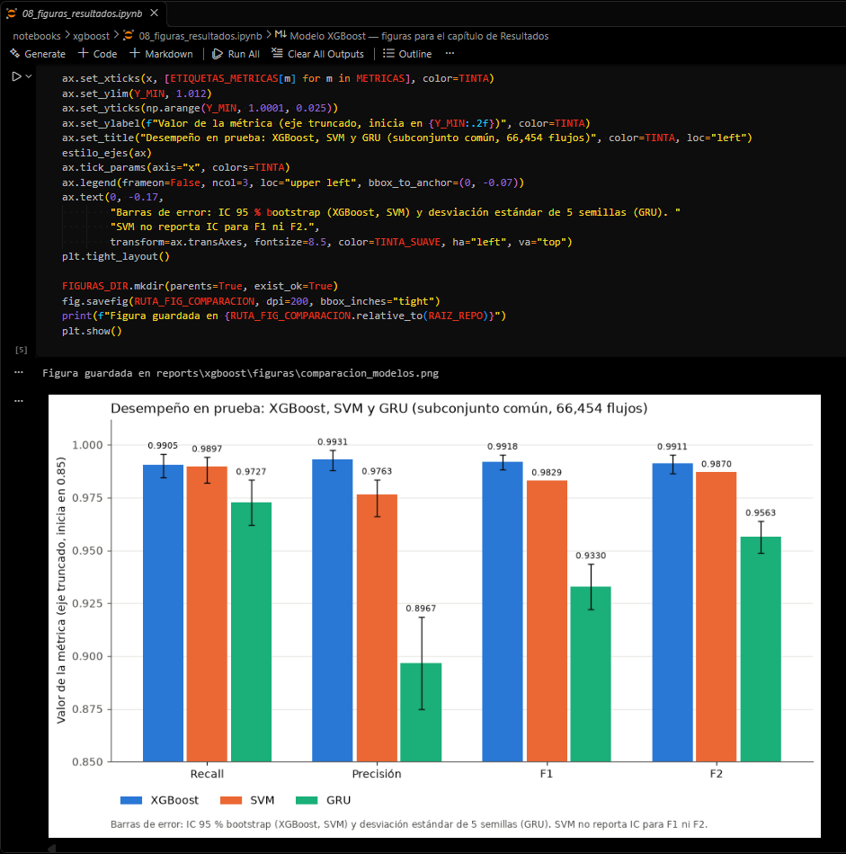
*Captura 10. Notebook 08: comparación de modelos.*

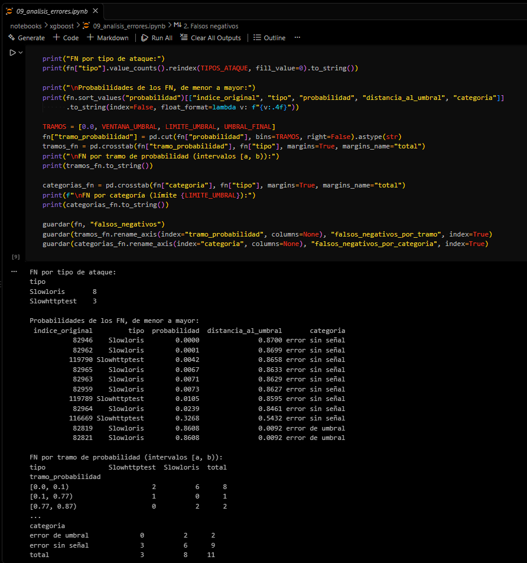
*Captura 11. Notebook 09: análisis de errores.*

## Demo

Video de demostración: [`demo/demo.mp4`](demo/demo.mp4)

## Documentación

- Informe final: [`docs/informe_final.pdf`](docs/informe_final.pdf)
- Consentimiento firmado: [`docs/consentimiento_firmado.pdf`](docs/consentimiento_firmado.pdf)

Documentación técnica adicional en [`src/docs/`](src/docs/): decisiones de arquitectura (ADR), auditoría del baseline de XGBoost y guía de pruebas.

## Autor

**Edwin Andrés Ortega Kou** — carné 22305

- Asesor: Ing. Luis Alberto Suriano
- Universidad del Valle de Guatemala, Facultad de Ingeniería, 2026

### Créditos

La limpieza base de los datos (`src/src/preprocessing/clean.py`) se desarrolló en conjunto con Esteban Zambrano Garoz (22119) y Juan Pablo Solís Albizurez (22102).

La demo original en Streamlit también se desarrolló en conjunto con Esteban Zambrano Garoz (22119) y Juan Pablo Solís Albizurez (22102). `src/app_demo/` es una adaptación que conserva solo el módulo XGBoost.

## Licencia

El código de este repositorio se distribuye bajo la licencia [MIT](LICENSE).

El dataset CIC-IDS2017 no se incluye y está sujeto a sus propios términos de uso, definidos por la University of New Brunswick (UNB) y el Canadian Institute for Cybersecurity (CIC).
